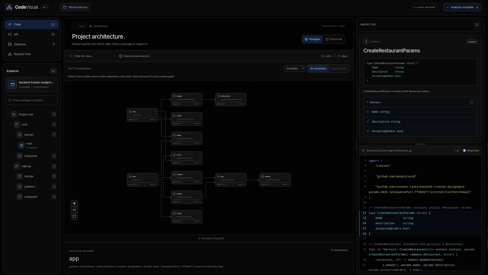
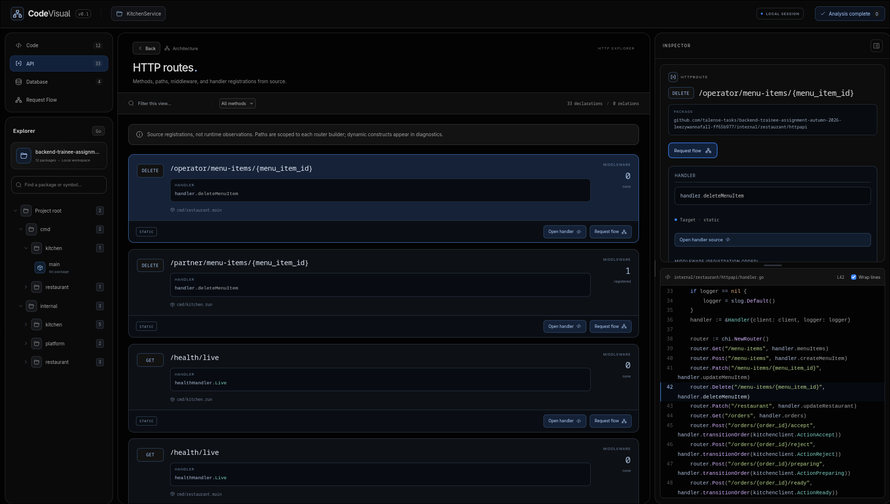
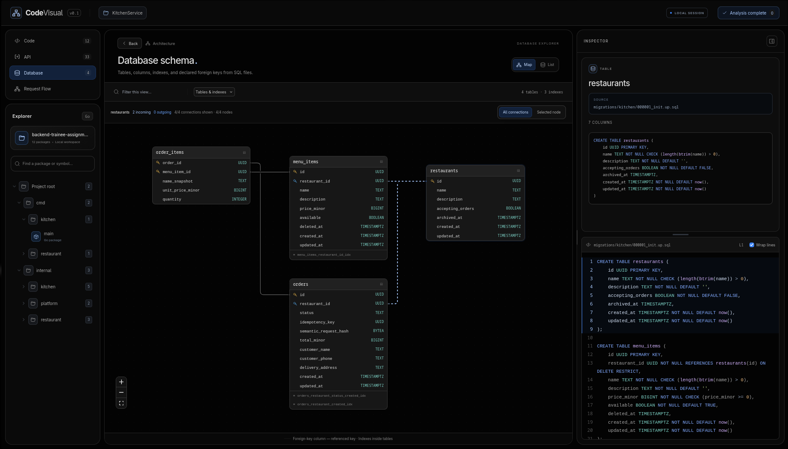

# CodeVisual

**Explore a Go project's architecture in your browser.**

See package dependencies, inspect source code, browse HTTP routes and SQL tables,
and follow potential request paths. Runs locally as a single Go binary — no account,
cloud service, LLM, or database connection required.



## Quick start

Requires **Go 1.26+**. The built frontend is included; Node.js is only needed for development.

Release archives contain a standalone binary for Linux, macOS, or Windows
(amd64 and arm64), plus this README and the license. Extract the archive for your
platform and run `codevisual analyze PATH` (`codevisual.exe` on Windows).
Go must be available in `PATH` for analysis; Node.js is not required.
Use `codevisual --version` to inspect the binary version.

```sh
go build -o bin/codevisual ./cmd/codevisual
./bin/codevisual analyze ./path/to/project
```

The browser opens at **http://127.0.0.1:7331**. Stop the server with `Ctrl+C`.

| Option | Purpose |
| --- | --- |
| `--port 7441` | Use a different local port |
| `--no-browser` | Skip opening the browser |
| `--tags integration,custom` | Analyze with Go build tags |

```sh
./bin/codevisual analyze ./path/to/project --port 7441 --no-browser
```

Analysis never downloads dependencies or toolchains. Prepare the target project's
dependencies beforehand for full type information. Missing dependencies or type
errors produce a partial analysis; click the status in the header to see diagnostics.
If Go is missing or older than Go 1.26 or the target module's `go` directive,
CodeVisual stops with installation guidance. Install a suitable Go version and
check `PATH`; analysis never installs it automatically.

## What you can explore

| Section | Features |
| --- | --- |
| **Code** | Package and directory maps, imports, types, methods, interfaces, and highlighted Go source |
| **API** | chi routes with paths, handlers, middleware, and links to source |
| **Database** | SQL table maps with columns, primary/foreign keys, indexes, and DDL source |
| **Request Flow** | Potential calls from a handler or function through the current module |

Click a package to see its declarations below the map. Expand **Methods** or select
an item to read its source in the resizable inspector. Double-click a package for
a dedicated symbol view.

Static chi router instances can be extended after a builder returns and mounted
under multiple prefixes. Mounted paths retain parent and child middleware.
The Request Flow entry-point picker searches all route pages, including projects
with more than 200 routes.

Drag the map background to pan and scroll to zoom. **Selected node** focuses on a
package and its direct neighbors. **Simplified** reduces redundant import lines;
**All imports** shows every direct import. An arrow `A → B` means **A imports B**.

Search packages and symbols in Explorer, or filter the current view above the map.
Switch between light and dark themes beside **LOCAL SESSION**.

<details>
<summary><strong>More screenshots — API & Database</strong></summary>

### HTTP routes



### Database schema



</details>

## Analysis limits

- **Static analysis:** CodeVisual does not execute project code, handlers, or migrations.
  Request Flow shows possible calls, not a runtime trace; interface implementations
  are explicitly marked as possible.
- **One Go module:** uses the host OS/architecture and supplied build tags, with cgo
  disabled. Tests, nested modules, vendor, and symlinked source are excluded.
  External packages appear as import references; their source is not analyzed.
- **Source declarations:** dynamic routes may remain unresolved. Database views read
  `CREATE TABLE` and `CREATE [UNIQUE] INDEX` from SQL files, not a final migrated
  schema. Down migrations are skipped; `ALTER` and `DROP` are diagnosed.
- **Bounded views:** graphs show at most 200 nodes; larger projects use directory
  views and paging. Restart analysis after changing source files.

The server listens only on `127.0.0.1`. Analysis leaves the target project's
`go.mod` and `go.sum` unchanged.

## Development

Requires **Go 1.26+**, **Node.js 22.16+**, and **npm**.

```sh
make build    # Build frontend and bin/codevisual
make dev      # Start backend and Vite development server
make test     # Run Go and frontend tests
make check-frontend # Rebuild and check embedded assets against the committed build
```

After frontend changes, commit the regenerated `internal/server/webdist` assets
so `go build` includes the updated interface.

For browser tests, build the binary first, then run:

```sh
cd web
npx playwright install chromium
npm run test:e2e
```

## Checks and release packaging

GitHub Actions runs Go tests, vet, and builds on Linux, macOS, and Windows.
The frontend job uses Node.js 22.16.0, installs dependencies with `npm ci`, runs
Vitest, checks TypeScript during the build, checks embedded asset freshness,
and runs the self-contained Playwright scenarios. Optional scenarios requiring
sibling repositories are skipped by default. A packaging job cross-compiles all
six supported OS/architecture combinations and checks archive checksums.

To build release archives locally (Python 3 and Go are required):

```sh
make build
make release VERSION=v0.2.0
```

Archives and `SHA256SUMS` are written to `dist/`. Verify downloaded archives with
`sha256sum --check SHA256SUMS` on Linux, `shasum -a 256` on macOS, or
`Get-FileHash -Algorithm SHA256` on Windows. For the latter two commands, compare
the resulting hash with the matching line in `SHA256SUMS`.

A pushed version tag such as `v0.2.0` runs all checks, builds the archives, and
creates a **draft** GitHub release with the assets. Review the draft before
publishing. Running the release workflow manually on a branch creates preview
artifacts without creating a release. No release is published automatically.

Built with Go, chi, React, TypeScript, XYFlow, and ELK. The frontend is embedded
in the binary; no runtime CDN is needed.

## License

Licensed under the [MIT License](LICENSE). Copyright (c) 2026 LeezyWannaFall.
