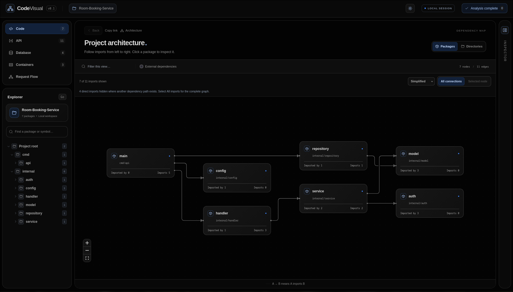
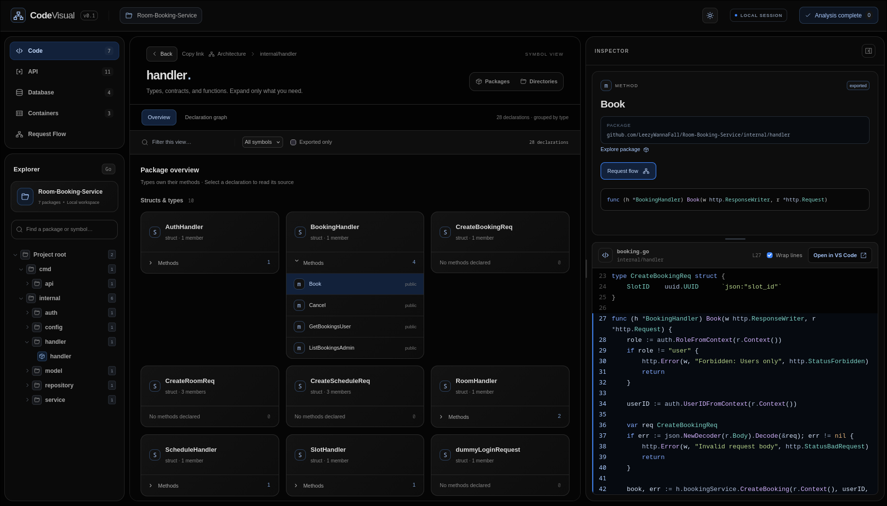
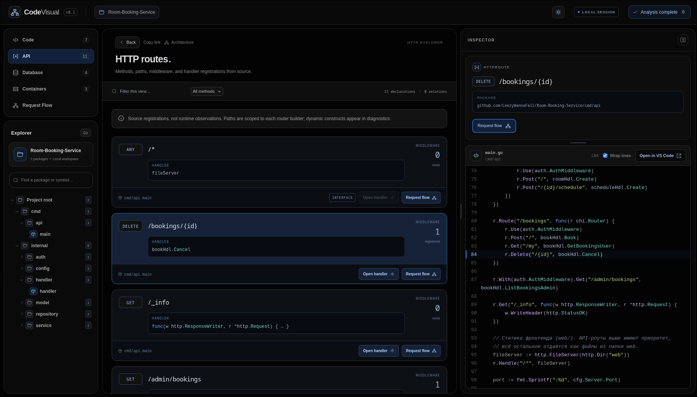
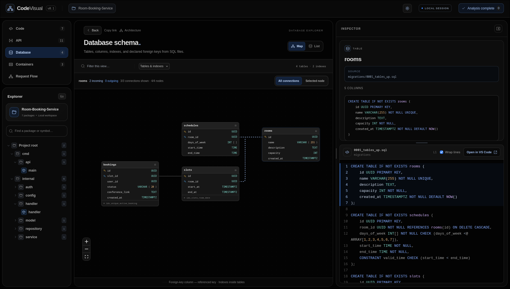

# CodeVisual

**English** · [Русский](README.ru.md)

**Explore Go, Python, and Docker architecture in your browser.**

Detect Go/Python projects automatically, inspect modules and declarations, browse
HTTP routes and SQL tables, follow potential calls, and explore Docker/Compose diagrams. Runs locally as a single Go binary — no account,
cloud service, LLM, or database connection required.



## Quick start

Building from source requires **Go 1.26+**. The built frontend is included;
Node.js is only needed for development.

Download a published version from [GitHub Releases](https://github.com/LeezyWannaFall/CodeVisual/releases).
Choose the archive for your system and architecture: Windows uses `.zip`,
Linux and macOS use `.tar.gz`; each has `amd64` and `arm64` variants.
Extract it and run `./codevisual analyze PATH` (Windows: `.\codevisual.exe analyze PATH`).
Each archive contains the binary with the embedded frontend, README, and LICENSE;
`SHA256SUMS` is attached separately. Draft releases appear publicly only after publication.

Alternatively, clone the repository and build from source using the commands below.
Runtime requirements depend on the detected sources:

- **Go:** Go 1.26+ in `PATH`, or the higher version required by the target module.
- **Python:** Python 3.9+ (`python3` or `python`) in `PATH`. No project packages need installation.
- **Docker/Compose:** no Docker daemon, Docker CLI, Go installation, or Python installation is required for configuration-only projects.

Mixed projects use both language analyzers. Node.js is not required to run the binary.
Use `codevisual --version` to inspect the binary version.

```sh
git clone https://github.com/LeezyWannaFall/CodeVisual.git
cd CodeVisual
go build -o bin/codevisual ./cmd/codevisual
./bin/codevisual analyze ./path/to/project
```

The browser opens at **http://127.0.0.1:7331**. Stop the server with `Ctrl+C`.

| Option | Purpose |
| --- | --- |
| `--port 7441` | Use a different local port |
| `--no-browser` | Skip opening the browser |
| `--tags integration,custom` | Analyze with Go build tags |

```sh
./bin/codevisual analyze ./path/to/project --port 7441 --no-browser
```

Analysis never downloads dependencies or toolchains. Prepare the target project's
dependencies beforehand for full type information. Missing dependencies or type
errors produce a partial analysis; click the status in the header to see diagnostics.
For Go modules, if Go is missing or older than Go 1.26 or the target module's `go` directive,
CodeVisual stops with installation guidance. Install a suitable Go version and
check `PATH`; analysis never installs it automatically.

## What you can explore

| Section | Features |
| --- | --- |
| **Code** | Go packages and Python modules, imports, functions, classes, methods, interfaces, and highlighted source |
| **API** | chi routes with paths, handlers, middleware, and links to source |
| **Containers** | Compose services, Dockerfile build stages, dependencies, networks, volumes, declared COPY/ADD and mount contents, and links to local code |
| **Database** | SQL table maps with columns, primary/foreign keys, indexes, and DDL source |
| **Request Flow** | Potential calls from a handler or function through the current module |

Click a package to see its declarations below the map. Expand **Methods** or select
an item to read its source in the resizable inspector. Double-click a package for
a dedicated symbol view.

The source inspector offers **Open in VS Code**, using the local VS Code URI
handler to open the selected declaration's line and column. VS Code must be
installed on the same computer as the analysis server. Reverse SQL migrations
named `*.down.sql` or `*_down.sql` are excluded.

Static chi router instances can be extended after a builder returns and mounted
under multiple prefixes. Mounted paths retain parent and child middleware.
The Request Flow entry-point picker searches all route pages, including projects
with more than 200 routes.

Use **Copy link** beside Back to save the current view. The URL retains the
selected declaration, filters, pages, graph settings, and Request Flow options.
Reloading or opening the link in another tab restores that view. Links refer to
this analysis at the same local server address; a changed analysis or missing
object is explained and opens the project overview.

**Back** and the browser's back/forward buttons restore the previous context.
Opening handler or middleware source takes you to its package; Back returns to
the route list with its filters. **Explore package** in the inspector opens the
owning package. Request Flow starts with the inspector collapsed and opens source
when you select a call target.

Empty filtered views offer **Clear view filters**. An out-of-range page offers
**First page**. Search in Explorer covers the whole project, while the filter
above the map applies to the current view. Paging and selection notices explain
results hidden by the current page or filters.

Drag the map background to pan and scroll to zoom. **Selected node** focuses on a
package and its direct neighbors. **Simplified** reduces redundant import lines;
**All imports** shows every direct import. An arrow `A → B` means **A imports B**.

Search packages and symbols in Explorer, or filter the current view above the map.
Switch between light and dark themes beside **LOCAL SESSION**.

<details>
<summary><strong>More screenshots — Code, API & Database</strong></summary>

### Package overview and source inspector



### HTTP routes



### Database schema



</details>

## Python and container analysis

The same `codevisual analyze PATH` command detects Go only, Python only, or both.
Explorer displays the detected languages. Python files do not require a `go.mod`;
a workspace without a root Go module can contain separate Go modules in child
directories. Their sources are rebased to the selected workspace for browsing.
A selected Go module keeps its own boundary and skips nested modules.

Python analysis uses an embedded helper with the installed interpreter's standard
`ast` module, in isolated mode with site hooks disabled. Project files are parsed
from input bytes, never imported or executed. It reads functions, async functions,
classes, methods, annotations, docstrings, imports, and direct lexical calls.
Unknown receiver types, reassigned or decorated bindings, and other dynamic calls end at explicit
boundaries; conditional declarations, wildcard imports, and syntax errors are
reported. Python web-framework route discovery is not implemented; API still
lists chi registrations. No Go-to-Python runtime call connections are inferred.

**Containers** shows static declarations rather than running containers. Each
Compose file is shown independently; overrides/includes/extends and host/`.env`
interpolation are not evaluated. All declared services are shown, including
profile-specific ones. The map includes `depends_on`, build stages, stage copies,
networks, and named volumes. Select a service or stage to see its image, workdir,
command, ports, environment key names, COPY/ADD paths, and mounts.

Local copies and bind mounts link to discovered Go/Python modules. `.dockerignore`
and Dockerfile-specific ignore rules filter copy associations. External paths,
remote build contexts, image filesystems, RUN output, archive extraction, and
compiled artifacts are not inspected. Multi-stage COPY shows the source stage;
it does not claim a generated binary contains particular source files. Unsupported
heredocs and path-changing copy flags are diagnosed. Nothing is built, pulled,
started, or executed by the Docker analyzer.

## Analysis limits

- **Static analysis:** CodeVisual does not execute project code, handlers, or migrations.
  Request Flow shows possible calls, not a runtime trace; interface implementations
  are explicitly marked as possible.
- **Go module context:** uses the host OS/architecture and supplied build tags, with cgo
  disabled. Each discovered module is loaded independently. Tests, nested modules
  within a module, vendor, and symlinked source are excluded.
  External packages appear as import references; their source is not analyzed.
- **Source declarations:** dynamic routes may remain unresolved. Database views read
  `CREATE TABLE` and `CREATE [UNIQUE] INDEX` from SQL files, not a final migrated
  schema. Down migrations are skipped; `ALTER` and `DROP` are diagnosed.
- **Bounded views:** graphs show at most 200 nodes; larger projects use directory
  views and paging. Restart analysis after changing source files.

The server listens only on `127.0.0.1`. Analysis leaves the target project's
`go.mod` and `go.sum` unchanged.

## Development

Requires **Go 1.26+**, **Python 3.9+**, **Node.js 22.16+**, and **npm**.
Virtual environments, Python test files/directories, caches, and symlinked source are excluded from discovery.

```sh
make build    # Build frontend and bin/codevisual
make dev      # Start backend and Vite development server
make test     # Run Go and frontend tests
make check-frontend # Rebuild and check embedded assets against the committed build
```

After frontend changes, commit the regenerated `internal/server/webdist` assets
so `go build` includes the updated interface.

For browser tests, build the binary first, then run:

```sh
cd web
npx playwright install chromium
npm run test:e2e
```

## Checks and release packaging

GitHub Actions runs Go tests, vet, and builds natively on Linux, macOS, and Windows.
Each native job includes Python 3.12 for the AST analyzer tests.
The frontend job uses Node.js 22.16.0, installs dependencies with `npm ci`, runs
Vitest, checks TypeScript during the build, checks embedded asset freshness,
and runs the self-contained Playwright scenarios, including analysis of this
checkout. Optional scenarios requiring sibling repositories are skipped by default. A packaging job cross-compiles all
six target OS/architecture combinations (cross-compilation does not verify native execution) and checks archive checksums.

Changes pushed to `main` update the repository and run CI; they do not change
an existing release or its archives. Documentation and CI updates alone do not
require a new release. To distribute a changed binary, publish a new version tag
(for example, `v0.2.1`) after committing the changes and passing checks.

To build release archives locally (Python 3 and Go are required):

```sh
make build
make release VERSION=v0.2.0
```

Archives and `SHA256SUMS` are written to `dist/`. Verify downloaded archives with
`sha256sum --check SHA256SUMS` on Linux, `shasum -a 256` on macOS, or
`Get-FileHash -Algorithm SHA256` on Windows. For the latter two commands, compare
the resulting hash with the matching line in `SHA256SUMS`.

A pushed version tag such as `v0.2.0` runs all checks, builds the archives, and
creates a **draft** GitHub release with the assets. Review the draft before
publishing. Running the release workflow manually on a branch creates preview
artifacts without creating a release. No release is published automatically.

Built with Go, chi, React, TypeScript, XYFlow, and ELK. The frontend is embedded
in the binary; no runtime CDN is needed.

## License

Licensed under the [MIT License](LICENSE). Copyright (c) 2026 LeezyWannaFall.
