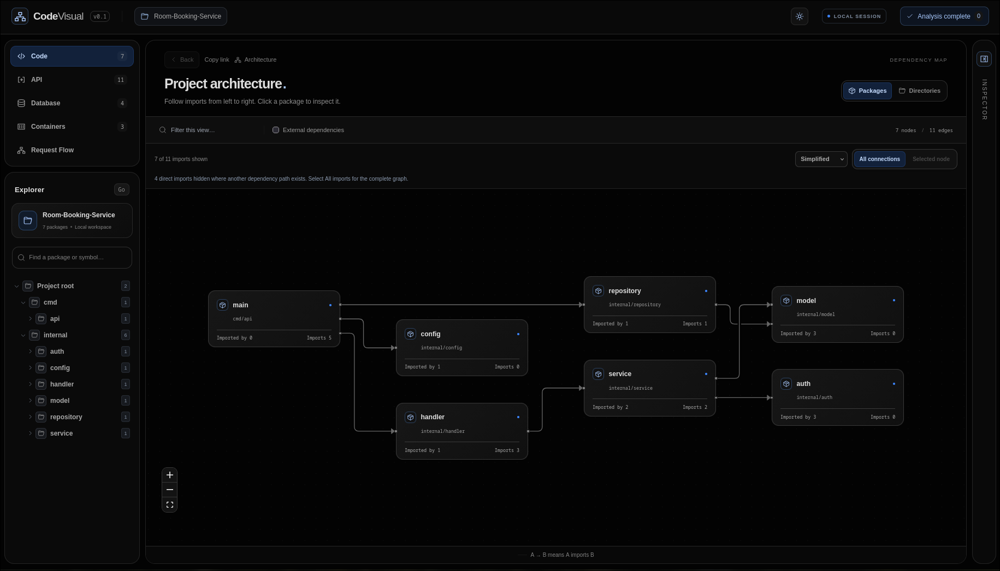
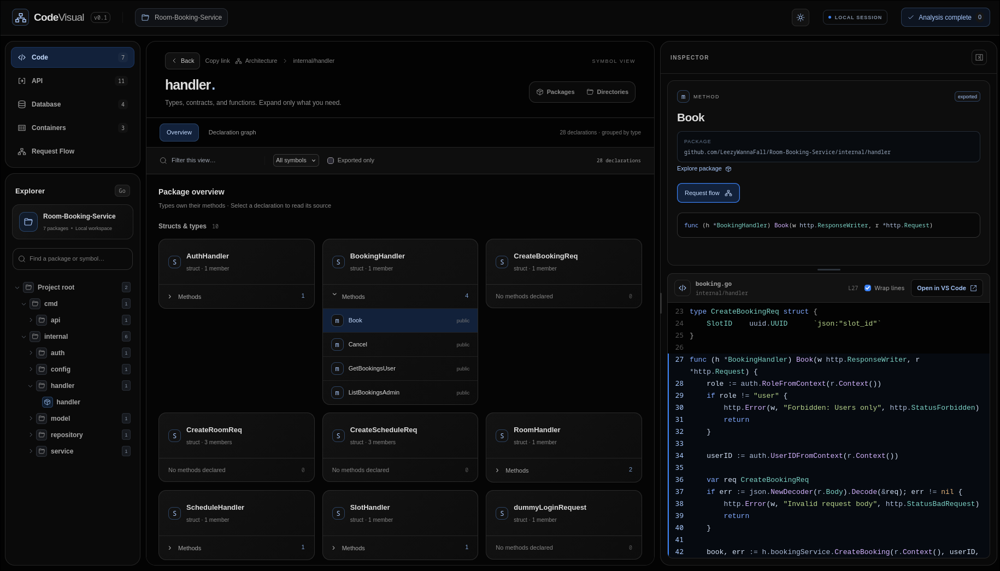
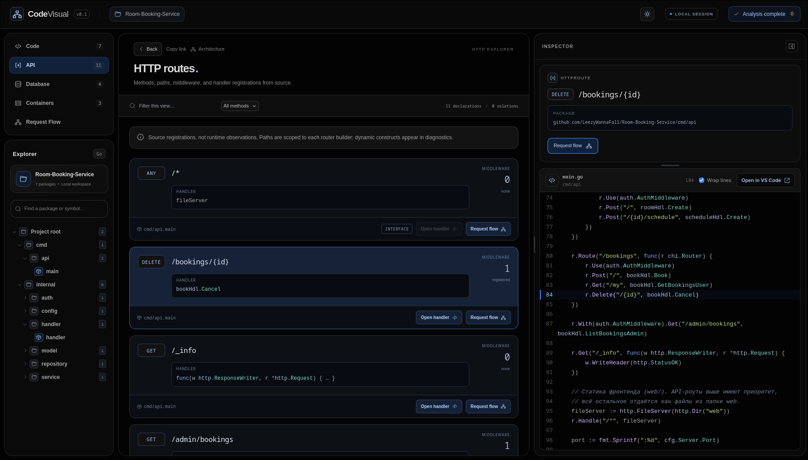
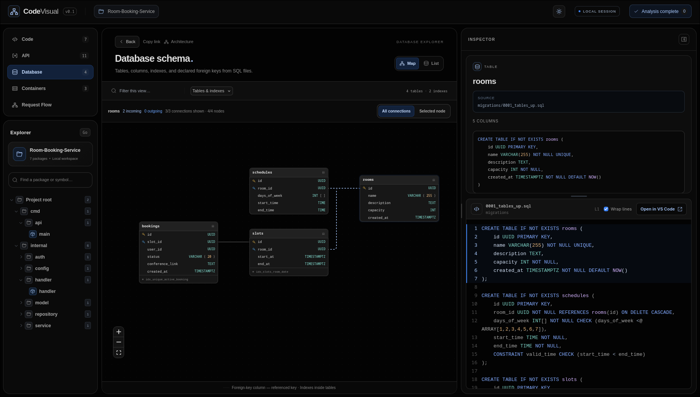

# CodeVisual

[English](README.md) · **Русский**

**Исследуйте архитектуру Go, Python и Docker в браузере.**

CodeVisual автоматически определяет языки проекта, строит карту пакетов и объявлений,
находит HTTP-маршруты и SQL-таблицы, показывает возможные вызовы и конфигурацию
контейнеров. Работает локально одним Go-бинарником со встроенным интерфейсом.
Аккаунт, облако, LLM и подключение к базе данных не нужны.



## Быстрый старт

Скачайте опубликованную версию из [GitHub Releases](https://github.com/LeezyWannaFall/CodeVisual/releases).
Выберите систему и архитектуру: для Windows — `.zip`, для Linux и macOS —
`.tar.gz`; доступны варианты `amd64` и `arm64`. `amd64` подходит для процессоров
Intel/AMD x86-64, `arm64` — для ARM64, включая Apple Silicon.

В архиве находятся `codevisual` (Windows: `codevisual.exe`), README и LICENSE.
Интерфейс уже встроен в программу. Файл контрольных сумм `SHA256SUMS` приложен отдельно.

Например, распаковка версии `v0.2.0` на Linux x86-64:

```sh
mkdir -p codevisual
tar -xzf codevisual_v0.2.0_linux_amd64.tar.gz -C codevisual
cd codevisual
./codevisual --version
./codevisual analyze /путь/к/проекту
```

Для macOS используйте архив `darwin` нужной архитектуры. В Windows распакуйте
ZIP через проводник, откройте терминал в полученной папке и выполните:

```powershell
.\codevisual.exe analyze C:\path\to\project
```

Требования зависят от исходников:

- **Go:** установленный Go 1.26+ в `PATH` либо более новая версия, указанная в `go.mod` цели.
- **Python:** Python 3.9+ (`python3` или `python`) в `PATH`. Устанавливать пакеты исследуемого проекта не требуется.
- **Только Docker/Compose:** Go, Python, Docker CLI и Docker daemon не нужны.

Смешанный проект использует оба языковых анализатора. Node.js для запуска готовой
программы не нужен. Браузер откроется по адресу **http://127.0.0.1:7331**.
Остановить сервер можно через `Ctrl+C`.

| Параметр | Назначение |
| --- | --- |
| `--port 7441` | Другой локальный порт |
| `--no-browser` | Не открывать браузер автоматически |
| `--tags integration,custom` | Go build tags для анализа |

```sh
./codevisual analyze /путь/к/проекту --port 7441 --no-browser
```

Анализ не скачивает зависимости и toolchain. Для полной информации о типах Go
подготовьте зависимости цели заранее. Отсутствующие зависимости и ошибки типов
могут дать частичный результат; диагностика доступна по статусу в шапке.
Если подходящий Go отсутствует, программа предложит установить его самостоятельно.

## Возможности интерфейса

Названия разделов и кнопок интерфейса остаются английскими.

| Раздел | Что показывает |
| --- | --- |
| **Code** | Пакеты Go и модули Python, импорты, функции, классы, методы, интерфейсы и исходники с подсветкой |
| **API** | Маршруты chi, пути, обработчики, middleware и переходы к исходникам |
| **Containers** | Сервисы Compose, стадии Dockerfile, зависимости, сети, тома, COPY/ADD и монтирования со ссылками на код |
| **Database** | Таблицы SQL, столбцы, первичные и внешние ключи, индексы и исходный DDL |
| **Request Flow** | Возможные вызовы от обработчика или функции |

Нажмите на пакет, чтобы увидеть объявления под картой. Двойной щелчок открывает
отдельное представление пакета. Структуры и интерфейсы разделены; **Methods**
раскрывает методы типа. Выбор объявления открывает исходник в инспекторе.
Ширину инспектора и соотношение его секций можно менять перетаскиванием разделителей.

**Open in VS Code** открывает строку и столбец выбранного объявления через локальный
URI-обработчик VS Code. Редактор должен быть установлен на компьютере сервера анализа.

**Copy link** сохраняет представление, выбранный объект, фильтры, страницы и параметры
Request Flow в URL. Перезагрузка и открытие ссылки в другой вкладке восстанавливают
контекст в рамках того же анализа и адреса сервера. Устаревшие ссылки получают пояснение.
**Back** и кнопки истории браузера возвращают к предыдущему состоянию.

Поиск Explorer охватывает весь проект; фильтр над схемой относится к текущему
представлению. **Clear view filters** сбрасывает фильтры, **First page** возвращает
к первой странице. Выбор точки входа Request Flow доступен и для маршрутов за
пределами первой страницы API.

Перетаскивайте фон для перемещения карты, используйте прокрутку для масштаба.
**Selected node** фокусирует связи выбранного пакета. **Simplified** сокращает
избыточные линии импортов, **All imports** показывает все прямые импорты.
Стрелка `A → B` на карте пакетов означает «A импортирует B».
Тема переключается рядом с **LOCAL SESSION**.

<details>
<summary><strong>Скриншоты: код, API и база данных</strong></summary>

### Объявления и исходники



### HTTP-маршруты



### Схема базы данных



</details>

## Python и контейнеры

Команда `codevisual analyze PATH` определяет Go, Python или оба языка. Python-проекту
не нужен `go.mod`. Workspace без корневого Go-модуля может объединять независимые
дочерние Go-модули и Python. Внутри выбранного Go-модуля вложенные модули пропускаются.

Python разбирается встроенным AST-helper через установленный интерпретатор
в изолированном режиме с отключёнными site hooks. Код цели не импортируется
и не исполняется. Анализируются функции и async-функции, классы, методы,
аннотации, docstrings, импорты и прямые лексические вызовы. Неизвестные типы
получателей, изменённые или декорированные bindings и другие динамические вызовы
имеют явные границы анализа. Условные объявления, wildcard-импорты и синтаксические
ошибки диагностируются. Поиск маршрутов Python-фреймворков пока не реализован:
раздел API показывает chi. Runtime-связи между Go и Python не выводятся.

**Containers** показывает статические объявления. Переключатели **All / Docker
Compose / Dockerfile** разделяют сервисы и стадии сборки. Сеть `default` скрыта
со схемы, но остаётся в деталях сервиса. **File transfers** раскрывает мини-схемы
«источник → назначение». Пунктирная карточка **Completion task** означает ожидаемое
завершение по условию `service_completed_successfully`, а не фактический статус.

Compose-файлы рассматриваются независимо: overrides/includes/extends не разворачиваются,
переменные хоста и `.env` не подставляются. Показаны все объявленные сервисы,
включая профильные. В деталях доступны образ, рабочая папка, команда, порты,
имена переменных окружения, COPY/ADD и монтирования.

Локальные копирования и bind mounts связываются с обнаруженными пакетами.
Учитываются `.dockerignore` и правила для конкретного Dockerfile. COPY/ADD
ограничены build context. Внешние пути, удалённые контексты, файловая система
образов, результат RUN, распаковка архивов и скомпилированные артефакты не исследуются.
COPY из другой стадии показывает стадию-источник, а не состав полученного бинарника.
Простые ARG/ENV подставляются в WORKDIR и COPY/ADD. COPY --exclude фильтрует
связи с известным кодом, COPY --parents сохраняет пути известных файлов, включая
границы /./. Неизвестные переменные, heredoc и отображения, требующие знания
файловой системы другой стадии, диагностируются.
Docker-анализ ничего не собирает, не скачивает и не запускает.

## Ограничения и безопасность

- Анализ не исполняет код проекта, обработчики или миграции. Request Flow —
  возможные вызовы, а не трассировка выполнения. Возможные реализации интерфейсов отмечены отдельно.
- Go анализируется с учётом ОС, архитектуры и build tags, с отключённым cgo.
  Модули загружаются независимо. Тесты, vendor, вложенные модули внутри модуля
  и исходники через символьные ссылки исключены. Внешние пакеты представлены импортами.
- Виртуальные окружения, Python-тесты и кеши исключены из обнаружения.
- Динамические маршруты могут остаться неразрешёнными. SQL-карта строится по
  `CREATE TABLE` и `CREATE [UNIQUE] INDEX`, а не по итоговому состоянию миграций.
  Обратные миграции `*.down.sql` и `*_down.sql` пропускаются; `ALTER` и `DROP` диагностируются.
- В схеме максимум 200 узлов; для больших проектов доступны каталоги и страницы.
  После изменения исходников анализ нужно перезапустить.

Сервер слушает только `127.0.0.1`. Анализ не изменяет `go.mod` и `go.sum` цели.

## Сборка и разработка

Для сборки со встроенным интерфейсом достаточно **Go 1.26+**:

```sh
git clone https://github.com/LeezyWannaFall/CodeVisual.git
cd CodeVisual
go build -o bin/codevisual ./cmd/codevisual
./bin/codevisual analyze /путь/к/проекту
```

Для разработки нужны **Go 1.26+**, **Python 3.9+**, **Node.js 22.16+** и **npm**.

```sh
make build          # Интерфейс и bin/codevisual
make dev            # Backend и Vite
make test           # Go- и фронтенд-тесты
make check-frontend # Проверка актуальности встроенных ресурсов
```

После изменения фронтенда пересоберите и включите в коммит
`internal/server/webdist`, чтобы Go-бинарник содержал актуальный интерфейс.
Для браузерных тестов сначала выполните `make build`, затем:

```sh
cd web
npx playwright install chromium
npm run test:e2e
```

## CI и релизы

GitHub Actions выполняет Go-тесты, vet и нативную сборку на Linux, macOS и Windows.
В этих задачах установлен Python 3.12. Фронтенд проверяется на Node.js 22.16.0:
`npm ci`, Vitest, TypeScript, сборка, актуальность встроенных ресурсов и Playwright,
включая анализ самого CodeVisual. Сценарии внешних репозиториев по умолчанию пропущены.
Отдельная задача собирает архивы для шести сочетаний ОС/архитектуры и проверяет
контрольные суммы. Кросс-сборка сама по себе не проверяет исполнение на целевой ОС.

Push в `main` обновляет репозиторий и запускает CI. Уже опубликованные архивы
от этого не меняются. Для изменений документации или CI новый релиз не обязателен;
для распространения нового бинарника нужен новый тег версии, например `v0.2.1`.

Отправка тега `v*` запускает проверки, упаковку и создание **черновика релиза**.
Перед публикацией проверьте описание и файлы. Ручной запуск release workflow
на ветке создаёт preview-артефакты без релиза. Автоматической публикации нет.

Локальная сборка архивов:

```sh
make build
make release VERSION=v0.2.1
```

Результат — архивы и `SHA256SUMS` в `dist/`. На Linux проверяйте скачанные архивы
командой `sha256sum --check SHA256SUMS`. На macOS используйте `shasum -a 256`,
на Windows — `Get-FileHash -Algorithm SHA256` и сравните значение с `SHA256SUMS`.

Проект использует Go, chi, React, TypeScript, XYFlow и ELK. Runtime CDN не нужен.

Повторные причины диагностик сгруппированы со счётчиком и раскрываемыми местами.
Ошибки загрузки исходников отличаются от ограничений анализа. Несовпадение версии
Go сборки и загрузчика отмечается один раз на модуль. Начальный масштаб больших
графов сохраняет читаемость; Fit view показывает всю карту, Selected node —
окружение узла, а каталоги помогают исследовать проект небольшими группами.
Документация объявлений доступна в инспекторе.

## Лицензия

[MIT](LICENSE). Copyright (c) 2026 LeezyWannaFall.
